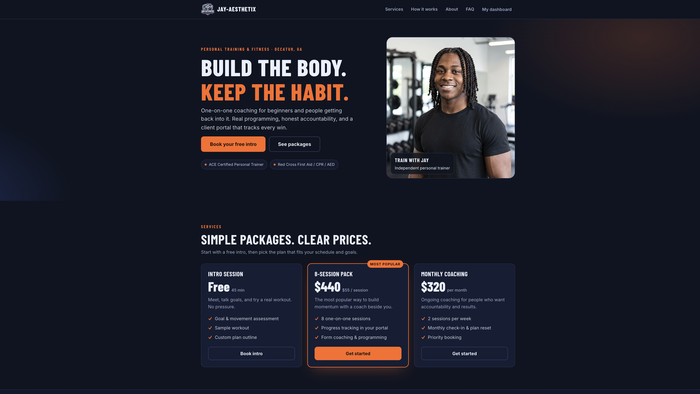
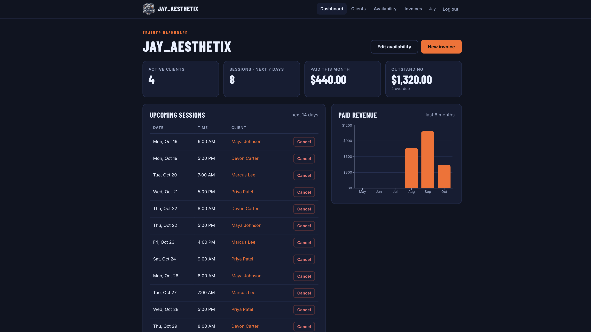
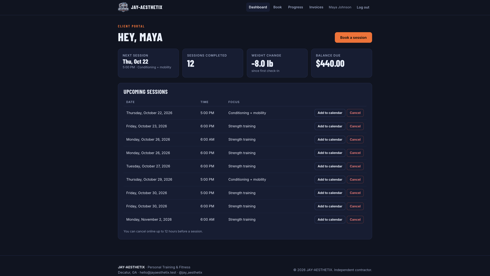
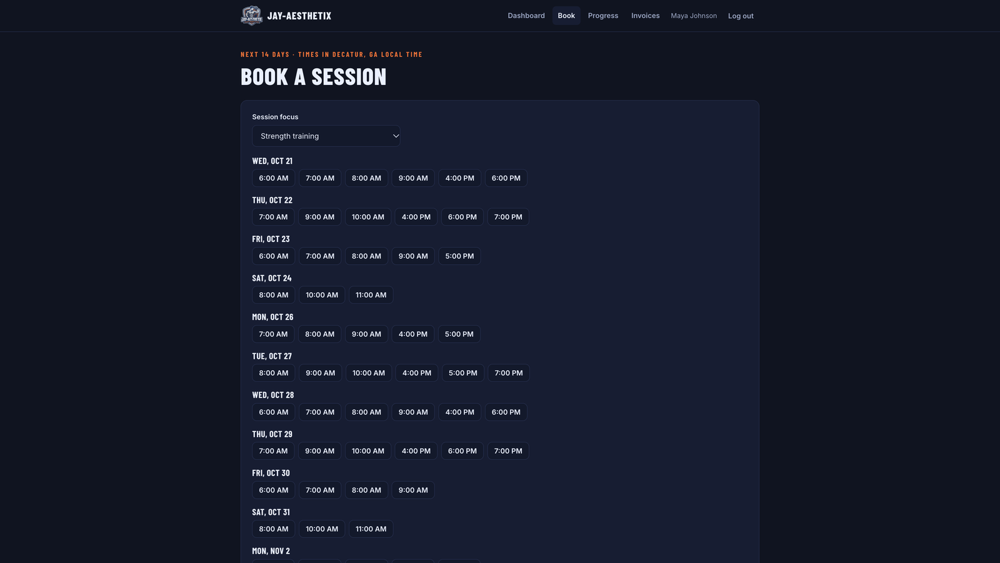
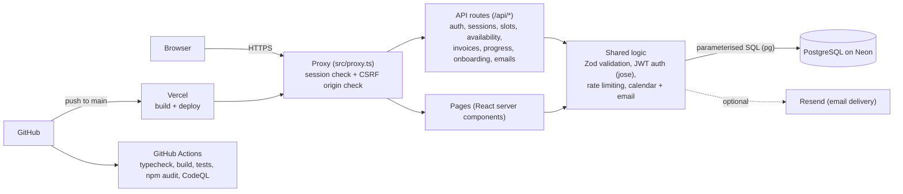
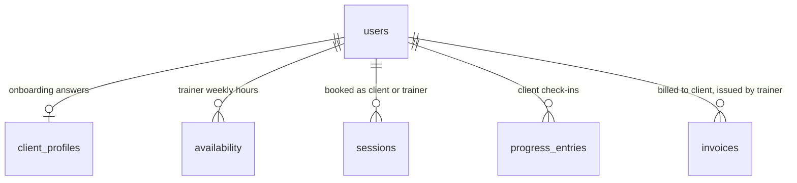

# JAY_AESTHETIX: Independent Trainer Platform

A full-stack web app for an independent personal trainer: a public marketing site plus a
login-protected portal where **clients** onboard, book sessions, and track progress, and the
**trainer** manages availability, clients, and invoices.

**Live demo:** https://jay-aesthetix.vercel.app/
Sample logins (demo data only): client `maya@example.test` / trainer `jay@jayaesthetix.test`, password `demo1234`.

https://github.com/user-attachments/assets/99ee04b5-c5d3-485a-85b8-3554662856f6









> **Portfolio concept project.** All clients, sessions, invoices, and prices are sample data, and
> payments are simulated. Set `NEXT_PUBLIC_DEMO_MODE=false` to hide the demo disclaimers.

**Stack:** Next.js 16 (App Router) · React 19 · TypeScript · PostgreSQL (`pg`) · JWT cookie auth (`jose`, `bcryptjs`) · Zod · Recharts · Vercel + Neon

## Architecture



## Data model



Supporting tables: `login_attempts` (failed logins, for rate limiting) and `email_log` (every email the app sends).

**Double-booking guard:** `sessions` has a partial unique index on (trainer, date, start time) where status is not `cancelled`, so Postgres itself rejects two active bookings of one slot, even under concurrent requests.

## Testing & CI


32 integration tests (`npm test`) run against the real app and database, covering:
- **Authentication:** HttpOnly cookies, and no account enumeration
- **Role-based access:** clients can't reach trainer endpoints or other clients' data
- **Concurrency:** 8 simultaneous bookings of one slot produce exactly one booking and seven `409`s
- **Brute-force protection:** account lockout after 5 failed logins and an IP limit after 50
- **Security headers and CSRF:** hardening headers on every response, and cross-site API requests refused
- **Calendar export:** the downloaded `.ics` time is converted back to the studio's clock and checked
- **Email notifications:** booking and cancellation emails go to the right people

GitHub Actions runs typecheck, build, the tests and a dependency audit on every push and pull request,
CodeQL scans the code, and Dependabot opens weekly update PRs.

To run them locally: `npm run build && npm start` in one terminal, then `npm test` in another.

## Security

Login rate limiting and lockout, a Content-Security-Policy and other hardening headers, CSRF origin
checks, parameterised SQL, role checks on every route, and a written threat model. See
[SECURITY.md](SECURITY.md) for what is protected, how, and the known limitations.

## Features

| Area | What it does |
| --- | --- |
| Marketing site | Hero, packages, how-it-works, about, FAQ, mobile-responsive, branded with the JAY_AESTHETIX identity |
| Auth | Client registration, login/logout, bcrypt-hashed passwords, httpOnly signed-JWT cookie, role-based access (trainer / client), login lockout |
| Onboarding | 3-step wizard: goals, health screening (PAR-Q style), schedule preferences. Saved per client and editable |
| Session booking | Trainer sets weekly availability. Clients see open 60-minute slots for 14 days and can book or cancel (12-hour cancellation window) |
| Calendar export | "Add to calendar" downloads an `.ics` file for any booked session (Apple, Google or Outlook), with the correct time zone and a 1-hour reminder |
| Email notifications | Booking confirmations, new-booking alerts and cancellation notices. Delivered through Resend when a key is set, and always recorded in the trainer's Email log |
| Progress analytics | Log weight, body fat, bench/squat/deadlift. Recharts line charts for body composition and strength |
| Invoice tracking | Trainer creates invoices, marks them paid or void. Overdue status is computed. Revenue chart and outstanding totals |
| Trainer dashboard | KPIs, upcoming sessions, sessions needing close-out, overdue invoices, new leads, 6-month paid revenue |

## Quick start

Requires **Node 20.6+** and a PostgreSQL database.

```bash
npm install
cp .env.example .env.local        # then edit AUTH_SECRET (see the file for a generator command)
docker compose up -d              # optional: local Postgres (or point DATABASE_URL at your own)
npm run db:setup                  # creates tables + loads demo data
npm run dev                       # http://localhost:3000
```

Demo logins (password `demo1234`):

- Trainer: `jay@jayaesthetix.test`
- Client: `maya@example.test`

`npm run db:reset` drops everything and reseeds.

## Design decisions (the interesting parts)

**Double-booking is prevented by the database, not just the UI.** Booking runs two checks. The API
first verifies the slot is inside the trainer's availability, in the future, and free (a friendly
error). The real guarantee is a partial unique index:

```sql
CREATE UNIQUE INDEX sessions_no_double_booking
  ON sessions (trainer_id, session_date, start_time) WHERE status <> 'cancelled';
```

If two people book the same slot at the same instant, Postgres rejects the loser (`23505`) and the API
returns `409`. Cancelling a session frees the slot again because the index ignores cancelled rows.
An automated test fires 8 simultaneous bookings and proves exactly one wins. Dropping the index makes it fail.

**One studio, one timezone.** Session times are stored as a `DATE` + `TIME` in studio-local time, with
"now" computed in `America/New_York` via `Intl`. That removes a whole class of timezone and DST bugs for a
single-location business. Calendar files convert that wall-clock time to a real UTC instant, so they land
correctly in anyone's calendar. Multi-location support would move to `timestamptz`.

**Auth.** Passwords are hashed with bcrypt. A 7-day JWT lives in an httpOnly, SameSite=Lax cookie. The
proxy (Next.js 16's middleware) gates page routes, and every API route and server page independently
re-checks the user and role from the database (defense in depth). Login does a dummy bcrypt compare when the
email is unknown so timing doesn't leak which emails exist, and failed attempts are throttled per email and
per IP, stored in Postgres so it works on serverless hosting.

**Email never breaks a booking.** Sending is wrapped so a provider outage or timeout (3 s limit) is recorded
as `failed` in the Email log while the booking itself still succeeds.

**Validation.** Every request body is parsed with Zod schemas (`src/lib/validators.ts`) and the database has
matching `CHECK` constraints.

**Data access.** Server components query Postgres directly. Mutations go through REST route handlers called
from small client components, followed by `router.refresh()`.

## REST API

| Method | Route | Who | Purpose |
| --- | --- | --- | --- |
| POST | `/api/auth/register` · `/login` · `/logout` | public | Account + session cookie (`429` after repeated failed logins) |
| POST | `/api/onboarding` | client | Save onboarding answers (upsert) |
| GET | `/api/slots?from=&days=` | any user | Open bookable slots |
| GET / PUT | `/api/availability` | trainer | Read / replace weekly availability (transaction) |
| GET / POST | `/api/sessions` | any user | List own sessions / book one (`409` on conflict) |
| PATCH | `/api/sessions/:id` | owner | Cancel (client, 12h rule) or cancel/complete (trainer) |
| GET | `/api/sessions/:id/calendar` | owner | Download the session as an `.ics` calendar file |
| GET | `/api/emails?sessionId=` | trainer | The email log, newest first |
| GET / POST | `/api/progress` | any user | Own entries / add a check-in (trainer can add for a client) |
| GET / POST | `/api/invoices` | any user / trainer | List own invoices / create one |
| PATCH | `/api/invoices/:id` | trainer | Mark paid, void, or reopen |

## Project structure

```
db/schema.sql           tables, constraints, double-booking index
scripts/db-setup.mjs    migrate + seed (demo data)
src/lib/                db pool, auth, slot engine, validators, rate limiting, calendar (.ics), email
src/app/api/            REST route handlers
src/app/(app)/          authenticated pages (dashboard, book, progress, invoices, clients, availability, emails)
src/components/         client components (wizard, booking picker, charts, forms)
tests/                  integration tests (auth, access control, booking races, security, calendar, email)
.github/                CI, CodeQL and Dependabot configuration
SECURITY.md             threat model and known limitations
```

Branding, prices, FAQ and credentials all live in `src/lib/site.ts`. Edit them to rebrand or go live.

## Deploying

1. Create a Postgres database (Neon, Supabase, Railway, or Render all work).
2. Push the repo to GitHub and import it into **Vercel**.
3. Set `DATABASE_URL`, `AUTH_SECRET`, and `NEXT_PUBLIC_DEMO_MODE` in the project's environment variables.
   Optional: `RESEND_API_KEY` and `EMAIL_FROM` to deliver real emails (otherwise they are only logged).
4. Create the tables once from your machine: `DATABASE_URL="<prod url>" node scripts/db-setup.mjs`.
   Note that this also seeds the **demo accounts with a known password**. For anything real, delete those
   users or skip the seed section. (The `login_attempts` and `email_log` tables create themselves on first use.)

## Known limitations / next steps

- No password reset or email verification.
- Payments are tracked, not processed (Stripe Checkout would be the natural next step).
- Health screening data is collected for demo purposes. A real deployment needs a privacy policy and
  appropriate handling of sensitive health information.
- Trainer-side booking for a client exists in the API but has no UI yet.
- More in [SECURITY.md](SECURITY.md#known-limitations-deliberately-out-of-scope-for-a-portfolio-app).
